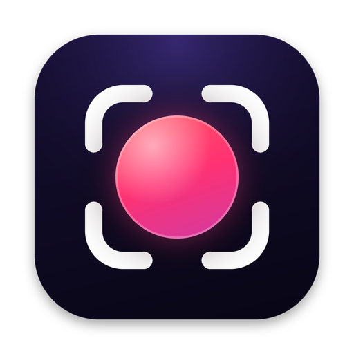
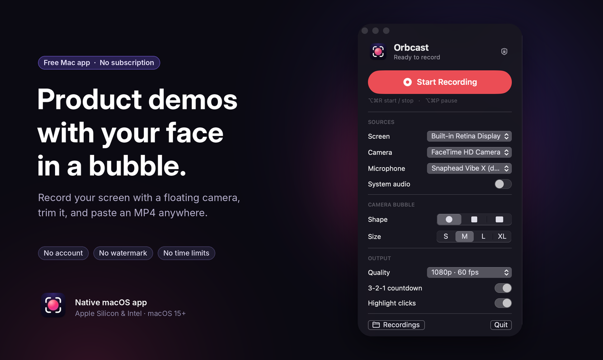

<p align="center">
  
</p>

<h1 align="center">Orbcast</h1>

<p align="center">
  <b>Product demos with your face in a bubble.</b><br>
  A free, open-source Mac app that records your screen with a floating camera bubble.<br>
  No account. No watermark. No time limits. Nothing uploaded.
</p>

<p align="center">
  <a href="https://orbcast.pages.dev/Orbcast.dmg"><b>Download for Mac</b></a> ·
  <a href="https://orbcast.pages.dev">Website</a> ·
  <a href="docs/README.md">Documentation</a>
</p>

<p align="center">
  
  
  
  
</p>

<p align="center">
  
</p>

## Features

| | |
| --- | --- |
| **Camera bubble** | Circle, rounded square or 16:9. Drag it anywhere, four sizes, mirrored like a real mirror. |
| **Screen + audio** | Any display at 1080p or 4K, 30 or 60 fps, with your microphone and optional system audio. |
| **Pause, restart, discard** | Pause without gaps in the file. Restart a bad take or throw it away in one click. |
| **Click highlights** | A ripple on every click so viewers can follow along. |
| **Invisible controls** | The control panel, recording bar and countdown never appear in the video. |
| **Trim & export** | Trim the start and end, export a web-ready MP4, copy it and paste into Slack or email. |
| **Global shortcuts** | <kbd>⌥</kbd><kbd>⌘</kbd><kbd>R</kbd> start / stop, <kbd>⌥</kbd><kbd>⌘</kbd><kbd>P</kbd> pause / resume, from any app. |
| **Private** | Recordings are saved to `~/Movies/Orbcast`. Orbcast has no servers and no analytics. |

## Install

1. [Download **Orbcast.dmg**](https://orbcast.pages.dev/Orbcast.dmg), open it and drag **Orbcast** into **Applications**.
2. Open Orbcast. It isn't notarized by Apple yet, so the first time macOS may block it:
   open **System Settings › Privacy & Security**, scroll down and click **Open Anyway**.
3. Allow **Camera**, **Microphone** and **Screen & System Audio Recording**, then click **Relaunch** in the welcome window.

Requires macOS 15 Sequoia or later, on Apple Silicon or Intel. Full guide: [docs/installation.md](docs/installation.md).

## Quick start

1. Pick your screen, camera and microphone in the control panel.
2. Press <kbd>⌥</kbd><kbd>⌘</kbd><kbd>R</kbd> (or **Start Recording**). A 3-2-1 countdown starts.
3. Talk through your demo. Drag the bubble wherever it's out of the way.
4. Press <kbd>⌥</kbd><kbd>⌘</kbd><kbd>R</kbd> again to stop. The review window opens: trim, **Export MP4**, **Copy**, share.

See [Using Orbcast](docs/using-orbcast.md) for every control.

## Build from source

```sh
git clone https://github.com/heres-sathya/orbcast.git
cd orbcast
./scripts/build.sh       # → build/Orbcast.app (universal)
./scripts/make_dmg.sh    # → dist/Orbcast.dmg
open build/Orbcast.app
```

Needs macOS 15+ and the Xcode Command Line Tools (`xcode-select --install`). No Xcode project, no dependencies.
Details: [docs/building-from-source.md](docs/building-from-source.md).

## Documentation

| Guide | What's inside |
| --- | --- |
| [Installation](docs/installation.md) | Download, the "Open Anyway" step, permissions, uninstalling |
| [Using Orbcast](docs/using-orbcast.md) | Recording, the camera bubble, shortcuts, review, trim and export |
| [Permissions & privacy](docs/permissions-and-privacy.md) | What each permission is for and what Orbcast never does |
| [Troubleshooting](docs/troubleshooting.md) | Fixes for the most common problems |
| [Architecture](docs/architecture.md) | How the app is built: ScreenCaptureKit, AVAssetWriter, windows |
| [Building from source](docs/building-from-source.md) | Build, package, release and deploy the website |

## Contributing

Bug reports, ideas and pull requests are welcome. Start with [CONTRIBUTING.md](CONTRIBUTING.md).

## License

[MIT](LICENSE) © 2026 Sathya Narayanan P
