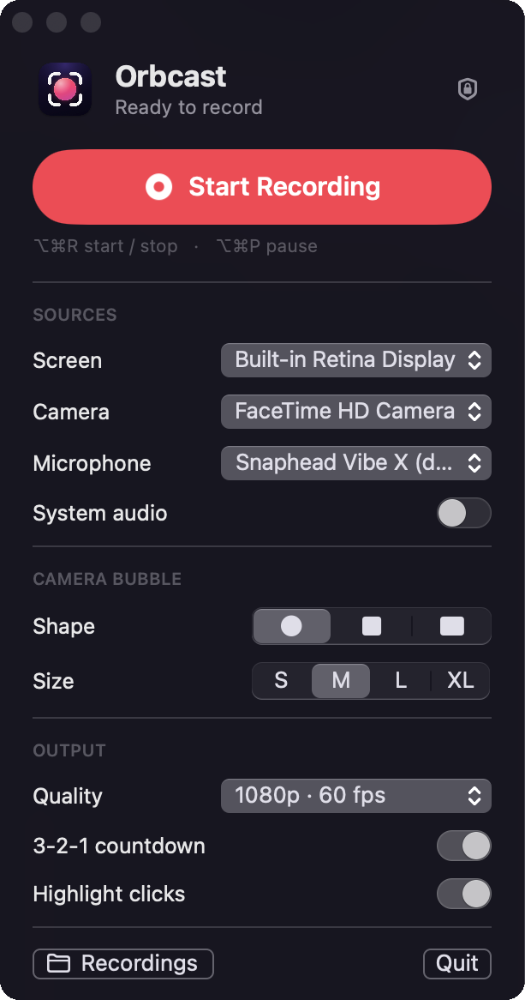

# Using Orbcast

Orbcast has three parts:

- **Control panel**: choose sources and settings, start recording.
- **Camera bubble**: a floating window showing your camera. It's part of the video.
- **Recording bar**: appears while recording, with stop, pause, restart, camera and discard.

The control panel, recording bar and countdown are hidden from the recording. Only your screen, cursor, the camera bubble and click highlights appear in the video.

 

## Record a demo

1. In **Sources**, pick the **Screen**, **Camera** and **Microphone**.
2. Press <kbd>⌥</kbd><kbd>⌘</kbd><kbd>R</kbd> or click **Start Recording**.
3. A 3-2-1 countdown appears. Click it to cancel.
4. Record. Use the recording bar or shortcuts to pause, restart or stop.
5. Press <kbd>⌥</kbd><kbd>⌘</kbd><kbd>R</kbd> or click the red stop button. The review window opens.

## Keyboard shortcuts

These work from any app, even when Orbcast is in the background.

| Shortcut | Action |
| --- | --- |
| <kbd>⌥</kbd><kbd>⌘</kbd><kbd>R</kbd> | Start / stop recording |
| <kbd>⌥</kbd><kbd>⌘</kbd><kbd>P</kbd> | Pause / resume |

Inside the app: <kbd>⌘</kbd><kbd>1</kbd> shows the control panel, <kbd>⌘</kbd><kbd>O</kbd> opens the recordings folder, <kbd>⌘</kbd><kbd>,</kbd> opens permissions.

## Control panel settings

| Setting | Options | Notes |
| --- | --- | --- |
| Screen | Any connected display | The bubble moves to this display when recording starts. |
| Camera | Built-in, external, Continuity Camera, or **No camera** | **No camera** hides the bubble. |
| Microphone | Any input, or **No microphone** | The system default is marked *(default)*. |
| System audio | On / off | Records sound from other apps on its own audio track. Orbcast's own sounds are excluded. |
| Shape | Circle, rounded square, wide 16:9 | Also in the bubble's right-click menu. |
| Size | S, M, L, XL | Also in the bubble's right-click menu. |
| Quality | 1080p 30 fps, 1080p 60 fps, 4K 60 fps (HEVC) | 1080p uses H.264 for maximum compatibility. |
| 3-2-1 countdown | On / off | |
| Highlight clicks | On / off | Purple ripple for left clicks, pink for right clicks. |

Settings are remembered between launches.

## The camera bubble

- **Move**: drag it anywhere.
- **Change shape or size**: right-click it, or use the control panel.
- **Hide / show**: the camera button on the recording bar, the bubble's right-click menu, or the menu bar icon. You can do this mid-recording.
- The preview is mirrored, like a mirror, and it's recorded exactly as you see it.

## While recording

| Recording bar button | What it does |
| --- | --- |
| ■ Stop | Stops and saves, then opens the review window |
| ❚❚ Pause / ▶ Resume | Pauses without leaving a gap or a frozen section in the video |
| ↺ Restart | Throws the current take away and starts a fresh countdown |
| Camera | Shows or hides the bubble |
| Trash | Stops and deletes the recording |

The bar also shows the timer and a microphone level meter. Drag it anywhere. The menu bar icon shows the timer too, and has the same actions.

## Review, trim and export

After you stop, the review window opens with your recording.

| Button | What it does |
| --- | --- |
| **Trim** | Drag the yellow handles to cut the start and end, then click **Trim** |
| **Copy** | Copies the file (the MP4 if you exported one) so you can paste it into Slack, Mail or Finder |
| **Show in Finder** | Reveals the file |
| **Delete** | Moves the recording to the Trash |
| **Export MP4** | Saves a web-ready H.264 MP4 (up to 1080p) next to the original, using your trim |

## Where recordings go

Recordings are saved to `~/Movies/Orbcast/` as `Orbcast <date> at <time>.mov`.
Exports are saved alongside as `.mp4`, or as `(trimmed).mp4` when trimmed. Open the folder from **Recordings** in the control panel.

Each `.mov` contains one video track, plus a microphone track and a system-audio track when those are on.
